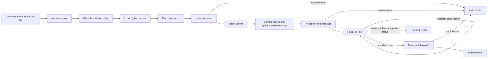

# ReelFlow AI

**A permission-aware Instagram Reel pipeline that turns a shared Reel into a scheduled post.**

ReelFlow AI connects Instagram messaging, a Google Sheets queue, local video processing, AI-assisted caption writing, and Instagram publishing. It is designed to keep each Reel traceable from the incoming link to its final result, while allowing the operator to edit or reject a draft before it is published.

> Use this project only for Reels you have permission to repost. Instagram availability, account permissions, and platform limits can still affect downloads or publishing.

## What it does?

- Receives Reel links from Instagram webhook events through a Cloudflare Worker relay.
- Filters incoming events to the configured sender and destination account, then deduplicates them.
- Downloads accessible Reels locally with `yt-dlp` and an optional signed-in Firefox session.
- Samples six low-detail frames with OpenCV and transcribes speech locally with faster-whisper (free; music-only clips return nothing).
- Makes one AI call per Reel for the caption, hashtags, an on-screen hook and a short commentary script.
- Renders a **commentary Reel** locally in three beats: a spoken intro that teases what the clip is about, the clip with its own sound, and a spoken ending that reacts and asks viewers a question to answer in the comments. Word-timed captions, a hook title and an `@creator` credit are burned in.
- Uses a free, natural Microsoft Edge neural voice (`TTS_ENGINE=edge`) and falls back to the offline Kokoro voice automatically.
- Speaks English or Hindi (`COMMENTARY_LANGUAGE=Hindi`: Hindi voice, Hinglish captions), with optional playful slang (`SLANG_LEVEL=off|mild|strong`) kept out of the hook, caption and hashtags and never used for slurs or when children are on screen.
- Credits the original creator in the caption and invites them as a collaborator when publishing.
- Optionally fills reserved slots with **original Reels**: an AI script and voiceover over free Pixabay or Pexels stock footage.
- Refuses to publish a raw, unchanged re-upload; Reels queued before the commentary step get commentary added and keep their slot.
- Schedules each ready Reel in the next available India-time slot: **11:00, 18:00, 22:00, or 23:00 Asia/Kolkata**.
- Publishes due Reels through Meta's Instagram Graph API and archives the result.
- Separates failed work and operator-rejected Reels so one problem does not block the rest of the queue.
- Runs as a local Windows background task; the computer must be awake and online for downloads and publishing.

## Why commentary and original Reels

Instagram stops recommending accounts that mostly re-upload other people's clips ("unoriginal content"). Small edits such as crops, borders, speed changes or a caption credit do not count as original. Added commentary and voiceover do, and an account becomes eligible again once most of its posts from the last 30 days are original. So the pipeline never posts a clip unchanged: every downloaded Reel gets a voiceover, and the optional original Reels keep the account's mix original.

## Workflow



### Queue lifecycle

| Sheet tab | Purpose |
| --- | --- |
| `Reel Link` | Incoming, deduplicated Reel links |
| `Video Convert` | Downloaded local videos waiting for analysis |
| `Ready to Post` | Captioned videos with the next available schedule |
| `Posted Reels` | Successfully published Reels and their post links |
| `Failed Links` | Download, analysis, scheduling, or publishing errors |
| `Rejected Reels` | Items explicitly rejected by the operator |

To reject a Reel, change its `status` in `Ready to Post` to the value configured by `REJECTION_STATUS` (default: `REJECTED`). The worker moves it to `Rejected Reels` on its next pass; it will not publish it. Caption edits in `Ready to Post` are picked up at publishing time.

## Setup

### Requirements

- Windows 10/11 and Python 3.10+
- Node.js/npm for deploying the optional Cloudflare Worker relay
- A Google Sheet and a Google service account with edit access to that sheet
- A Meta developer app with Instagram messaging/webhook and content-publishing setup
- An API key for the configured caption model; audio transcription is optional when a Reel has no usable audio

### Install the Python worker

```powershell
py -3 -m venv .venv
.\.venv\Scripts\python.exe -m pip install -r requirements.txt
Copy-Item .env.example .env
```

Fill the required values in `.env` on your computer. Save your Google service account credentials as `service-account.json`, grant that service account access to the spreadsheet, then create the workflow tabs:

```powershell
.\.venv\Scripts\python.exe pipeline.py setup
```

The real `.env` and credential file are intentionally excluded from Git. Never paste their contents into an issue or chat.

Download the free local voice model once (about 120 MB, from the kokoro-onnx GitHub release):

```powershell
.\.venv\Scripts\python.exe pipeline.py setup-voice
```

To try the commentary step on any local clip without touching the sheet or Instagram:

```powershell
.\.venv\Scripts\python.exe pipeline.py preview --video media\clip.mp4 --creator their_username
```

For original Reels, create a free Pixabay account and copy the key shown at https://pixabay.com/api/docs/ into `PIXABAY_API_KEY` in `.env` (a Pexels key in `PEXELS_API_KEY` also works, but Pexels paused new keys in November 2026), and choose `ORIGINAL_SLOTS` and `ORIGINAL_NICHE`. `pipeline.py preview-original` renders a sample. Without a key, every slot is a commentary Reel.

After changing the voice or style, re-edit everything already scheduled (stop the worker first so sheet rows do not move; each Reel keeps its slot):

```powershell
.\.venv\Scripts\python.exe pipeline.py rerender
```

### Configure Meta and the relay

1. Create/configure a Meta app for the Instagram account and grant the required publishing and messaging permissions.
2. Deploy the relay from `cloudflare-relay/deploy.ps1`. The script creates a private local `wrangler.toml` from `wrangler.example.toml` when needed, provisions the KV binding, stores secrets with Wrangler, and deploys the Worker.
3. Set Meta's webhook callback to the deployed Worker endpoint ending in `/meta/webhook`, complete Meta's verify-token check, and subscribe to the `messages` field.
4. Configure the sender/destination filters and relay settings in `.env`.

The public template contains no account ID or KV namespace ID. Wrangler creates/updates the private local config during deployment; that local config and `.wrangler` state are ignored by Git.

### Run locally

For a foreground session:

```powershell
.\.venv\Scripts\python.exe pipeline.py run
```

For unattended Windows use, configure Task Scheduler to run the same command at user logon, with the project directory as the working directory and multiple instances set to **Ignore new instance**. Keep the PC awake and online for scheduled publishing. The deployed Worker can queue webhook events while the PC is offline; the local worker processes them when it runs again.

## Failure handling

- Downloads retry automatically up to the configured attempt limit. Unresolved failures are recorded in `Failed Links`; the worker continues with other Reels.
- After fixing a download/cookie problem, stop the current worker, then run:

  ```powershell
  .\.venv\Scripts\python.exe pipeline.py retry-downloads
  ```

- For an analysis failure where the video is already downloaded, run:

  ```powershell
  .\.venv\Scripts\python.exe pipeline.py retry-analysis
  ```

- Publishing failures are recorded for inspection. Do not blindly retry a publish: Meta may have accepted a post even if the client did not receive a successful response, which can create duplicates.
- If Google Sheets returns a quota error, avoid running multiple workers and wait before retrying.

## Privacy and security

- `.env`, service-account credentials, Meta tokens, webhook-event logs, local Wrangler config/state, cookies, media, and personal setup notes are excluded by `.gitignore`.
- `.env.example` contains variable names and placeholders only; put real values in the ignored `.env` file.
- The relay verifies Meta webhook signatures and stores only the event fields needed to retrieve and deduplicate shared Reel links.
- Video files stay on the local computer; the AI step receives sampled frames and, when available, a compressed audio transcription input—not a request to fetch the Instagram URL itself.
- Before pushing changes, inspect `git status` and run a secret scanner. Never commit `.env`, `service-account.json`, `meta-token.json`, `.wrangler/`, or files from `media/`.

## Limitations

- Instagram does not guarantee that every shared Reel can be downloaded. Private, removed, region-restricted, or otherwise inaccessible media may fail even when the sender has permission to repost it.
- Visual analysis samples up to eight frames, so brief events between samples can be missed. Audio transcription is optional and incurs provider usage when audio is available.
- The local computer performs downloads and publishing. Sleep, shutdown, internet loss, expired permissions, rate limits, and API budget limits can delay or stop work.
- This project uses platform APIs and local automation; it does not bypass Instagram access controls.

## Technology

Python · Google Sheets API · Meta Instagram Graph API · Cloudflare Workers/KV · yt-dlp · OpenCV · FFmpeg · Edge neural TTS · Kokoro TTS · faster-whisper · Pillow · Pixabay / Pexels APIs · OpenAI-compatible vision API
